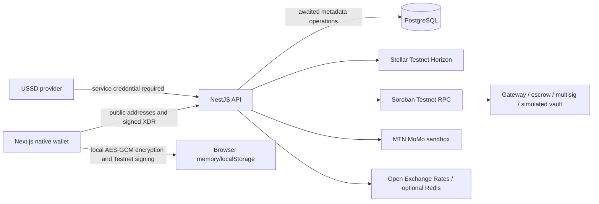

# Verified current-state audit

Audit date: 2026-10-23 (Africa/Lagos). Baseline: `7b36620bee895ecf8dd409c3e3c3efda69099a81`, fetched `origin/main`; no divergence or pre-existing working-tree edits. Work branch: `fix/afripay-security-and-drips-readiness`.

This is a maintainer-assisted source review and execution record, not an independent security audit. The source, tests, manifests, lockfiles, environment examples, migrations, deployment entry points, workflows, documentation, tracked assets, history, and GitHub issue/PR records were inspected. There were no tracked `.vscode` tasks/settings or executable binaries. Package lifecycle scripts contain normal build/dev/test commands; dependencies were initially installed with lifecycle execution disabled.

## Baseline verified from source

| Capability | Baseline classification | Evidence and defect |
|---|---|---|
| Native key generation/import, encryption, unlock | Implemented, inadequately tested | AES-GCM, random 16-byte salt/12-byte nonce, PBKDF2-SHA256/310,000 iterations; public-key/metadata tampering not checked |
| Native XLM send | Partially implemented; unsafe signing review | UI trusted backend XDR after source-only check; fixed fee; no reserve validation; memo omitted from request |
| Settlement verification | Broken integrity boundary | Submission marked intent SUCCEEDED without independent ledger query or intent operation validation |
| Payment persistence | Partial | PostgreSQL migration present; memory cache authoritative after startup; writes unawaited and errors swallowed |
| Payment links | Partial | Create/read API existed; `/pay/[id]` UI missing |
| Gateway | Implemented attestation model | Confirmer/payer authorization and replay tests; no token transfer or proof verification; initialization lacked consent |
| Escrow | Partial; inadequate authorization policy/tests | Asset fund/release/refund existed; only legacy create tests; beneficiary could release immediately; expiry not enforced consistently |
| Multisig | Partial; inadequate transfer tests | Asset transfer implementation existed alongside legacy metadata proposals; duplicate signer sets accepted |
| Vault | Demonstration | Arithmetic ledger with simulated yield; no token custody/transfer/real yield source |
| MoMo | Sandbox integration, external-service dependent | OAuth, collection, disbursement, callbacks/polling; provider credentials not supplied; durability/idempotency unsafe across instances |
| USSD | Demonstration | Menu/session map; false transfer/SMS promise; requested a PIN without an authentication implementation |
| KYC, notifications, central webhook router | Scaffold/missing | Empty modules; no operational provider integration |
| Internationalization | Missing | English UI only |
| CI | Implemented but incomplete | Unit/lint/build jobs; no PostgreSQL service, fmt/WASM checks, least-privilege permissions or secret/advisory checks |

Baseline local contract execution: 20 tests passed (2 escrow, 9 gateway, 4 multisig, 5 vault). Baseline frontend existing tests: 9 passed. Current results and limitations are in [PROJECT_READINESS_REPORT](../PROJECT_READINESS_REPORT.md).

## Dependency and trust map

Native XLM sends do not invoke Soroban. MoMo is not an implemented Stellar settlement bridge. Browser secret seeds never belong in API requests. Public intent/link metadata is not private: a wallet address alone is not authenticated user identity. Service API keys must never be distributed in browser configuration.

## External evidence boundaries

Public frontend/API availability and documented contract instances were queried read-only; raw public probe results are in [deployment-probes.json](evidence/deployment-probes.json). Local fixes are not deployed. Existing on-chain contracts are historical artifacts and do not automatically include this branch's changes. The live native payment evidence is in [TESTNET_PAYMENT_EVIDENCE](TESTNET_PAYMENT_EVIDENCE.md).

All 12 open issues and 15 closed issues were inspected, together with 16 PR descriptions/discussions. Their code-to-criteria reconciliation is in [REMAINING_WORK](REMAINING_WORK.md). Historical issue closure is not proof of complete functionality. No issue was automatically closed.

The user reports an appeal dismissal on September 18, 2026 and two appeals remaining. The original rejection date is not known. Baseline `main` has no commits after September 18; only this remediation's new commits can be described as after that dismissal.
